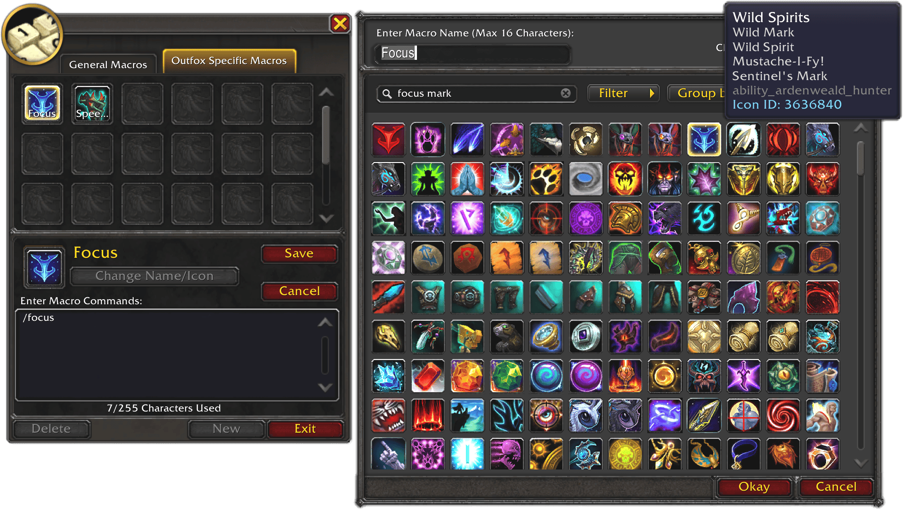
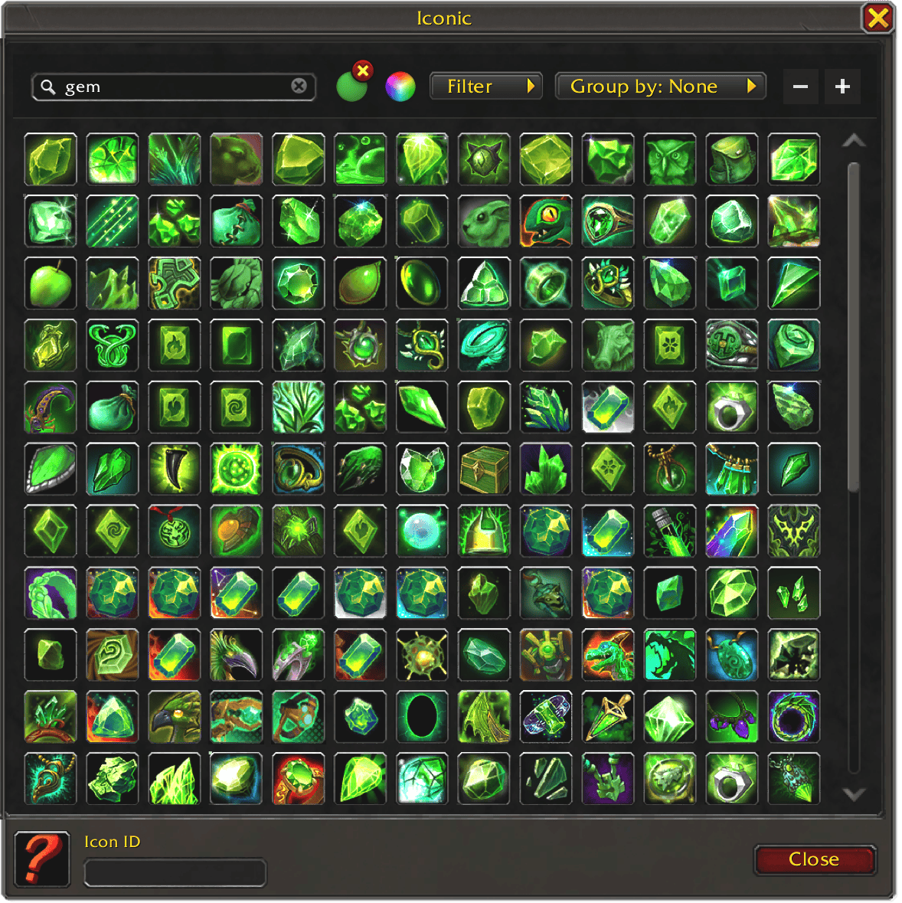
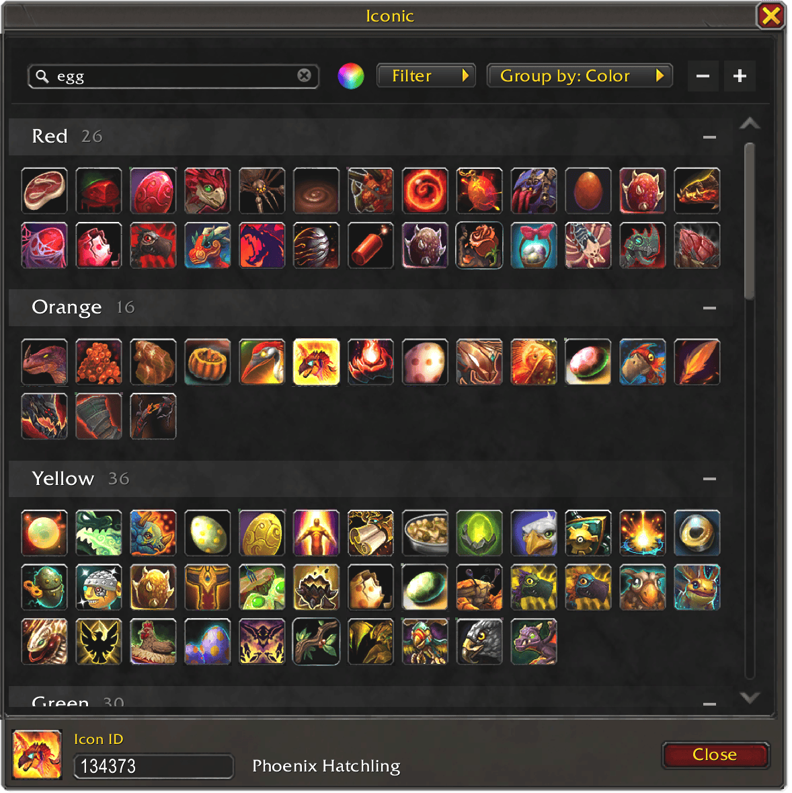

  

# Iconic

**A searchable icon picker for World of Warcraft: WoW Forever and retail.**

Iconic replaces the icon grid wherever the game lets you choose an icon: macros, equipment sets, bank tabs, guild bank tabs and transmog outfits.

> ⚠️ **Early version:** please report bugs on [GitHub](https://github.com/whytspace/Iconic/issues).

## Features

- **Search** by spell, item, mount, pet, achievement and currency names, spell descriptions and icon file names. "target" finds Hunter's Mark, synonyms find related words, and typos still show close matches.
- **Colours**: add up to three colour chips next to the search box, from the colour picker or by typing a colour such as "green" and taking the suggestion. Icons rank by how close they are to the colours, with or without words.
- **Filter** by source, class, item category and profession, or show only your own spells and items.
- **Group** the grid by the same categories.
- **Recently used** icons come first.
- **Icon IDs** in tooltips, always or while holding Shift, Ctrl or Alt (Options → AddOns → Iconic).
- `/iconic` opens a standalone browser to look up icons and copy their IDs.

## Getting started

1. Open the macro window (`/macro`) and create or edit a macro. Iconic replaces the icon grid.
2. Type in the search box, or pick filters from the toolbar.
3. Type `/iconic` to browse icons without changing anything, and `/iconic settings` for the options.

## Languages

Iconic is English only for now.

## For add-on authors

`Iconic.OpenPicker(onChoose, opts)` opens Iconic as a picker for your add-on. `Iconic.RegisterPicker(frame, adapter)` puts Iconic into your own icon picker. See `UI/API.lua`.

## Screenshots

| | |
|---|---|
|  |  |

## Data

Icon names and categories come from the game's data tables via [wago.tools](https://wago.tools).

## License

Released under the [MIT License](LICENSE).
